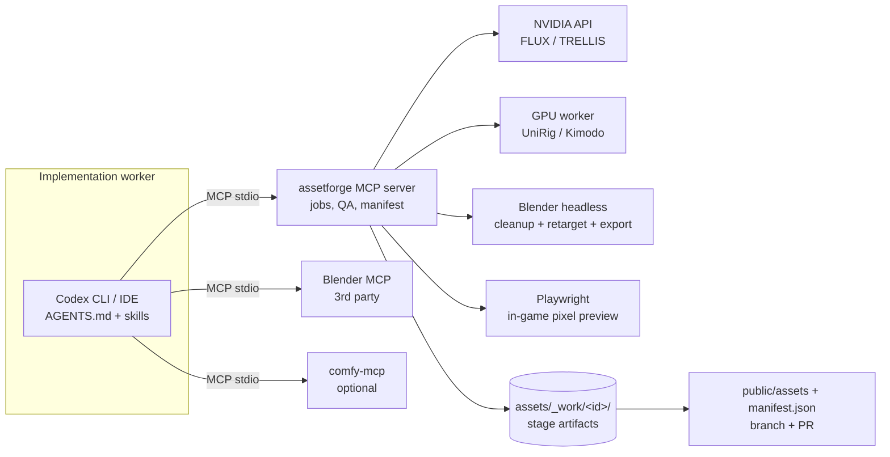

# Asset & Animation Generation Pipeline (Proposed)

**Status: PROPOSED — not locked.** Nothing here is implemented, and no decision in this document is LOCKED until the owner says so (see `docs/DECISIONS.md`, D-013 to D-016). Follows the repo rule: no new framework without a ticket that proves the need.

## 1. Goal and principles

Codex, in its role as implementation worker (see `AGENTS.md` §4), drives the pipeline for the assets named in a READY ticket: it reads the design docs, writes asset specs, calls pipeline tools over MCP, inspects the results, and opens PRs. The planning/review agent writes the asset tickets; the owner makes every subjective art decision. The pipeline does the generation. Rules for agents are in `AGENTS.md` §12.

1. **One thin custom MCP server (`assetforge`)** owns orchestration, jobs, QA and provenance. Do not adopt a large agent framework.
2. **Reuse existing MCP servers** for ComfyUI and Blender instead of rewriting them.
3. **Models are swappable providers** behind one adapter interface (NVIDIA API today, self-hosted or other tomorrow).
4. **Deterministic post-processing enforces the art style.** Models drift; a palette/poly/texel pass does not.
5. **Humans gate style decisions.** Automation proposes, the owner approves concept and final look.
6. **Every asset has a provenance manifest** (model, version, prompt, seed, license, hash).

## 2. Architecture



## 3. Stages

| # | Stage | Input → Output | Tool / model | Gate |
|---|-------|----------------|--------------|------|
| 0 | Spec | design docs → `spec.json` (id, category, style tokens, tri budget, palette, skeleton, clip list) | Codex | schema validation |
| 1 | Concept | spec → concept PNGs | FLUX.1-dev/schnell (NVIDIA API); FLUX Kontext / Qwen-Image-Edit for edits | **G1 owner approves** |
| 2 | Mesh | approved concept (or text) → raw GLB | TRELLIS (NVIDIA API; self-host NIM later) | auto QA |
| 3 | Cleanup | raw GLB → game-ready GLB | Blender headless: decimate to budget, fix normals/scale/origin, quantize textures to game palette, downscale to target texel density, flat/faceted shading | auto QA |
| 4 | Rig (characters/creatures only) | GLB → rigged GLB on canonical skeleton | UniRig, then bone-map to canonical skeleton | auto QA + weight-paint review |
| 5 | Motion | clip list → named animation clips | Kimodo text-to-motion (SOMA skeleton) → Blender retarget → foot-lock / loop cleanup | auto QA |
| 6 | Preview | GLB (+ clips) → contact sheet rendered **through the game's own low-res pipeline** | Playwright on look-dev scene | **G2 owner approves** |
| 7 | Publish | approved asset → `public/assets/<category>/<id>/` + `manifest.json` | assetforge | PR review |

Props, buildings and foliage skip stages 4–5. Start with those.

## 4. assetforge MCP tools (proposed)

All long-running tools are **async**: they return a `job_id` immediately; Codex polls `job_status`. This avoids tool-timeout failures.

- `spec_validate(spec)` — check against schema and style bible limits
- `concept_generate(spec_id, n, seed?)`, `concept_edit(image, instruction)`
- `mesh_generate(spec_id, concept_id | prompt)`
- `mesh_cleanup(job_id, profile)` — profile from `style_profile.json` (tri budget, palette, texel density)
- `rig_character(job_id, skeleton="canonical-humanoid")`
- `motion_generate(job_id, clip, prompt, seconds)` and `motion_retarget(...)`
- `preview_render(job_id, views, clips?)` — returns contact-sheet image paths for Codex/owner review
- `qa_report(job_id)` — machine-readable pass/fail with measured numbers
- `publish_asset(job_id)` — writes files + manifest, never commits by itself
- `job_status`, `job_list`, `cost_report`

Roles (art director, QA reviewer) are **prompts/profiles inside Codex or the server**, not separate agent frameworks. A vision-capable model can read contact sheets for a second opinion, but the owner decides at G1 and G2.

## 5. Providers (adapter interface)

```yaml
# tools/assetforge/providers.yaml (sketch)
concept_image: [nvidia:flux.1-dev, nvidia:flux.1-schnell, comfy-local]
image_edit:    [nvidia:flux.1-kontext-dev, nvidia:qwen-image-edit]
mesh:          [nvidia:trellis, self-hosted:trellis-nim]
rig:           [gpu-worker:unirig]
motion:        [gpu-worker:kimodo, library:cc0-clips]
```

Each adapter implements `submit(params) -> handle`, `poll(handle) -> status`, `fetch(handle) -> files`, and reports cost and license metadata.

**Compute tiers**
- **Tier A (no local GPU):** concept + mesh via NVIDIA API; rig and motion on a rented GPU worker (Modal, vast.ai, Cloud Run).
- **Tier B (local CUDA GPU):** same, with UniRig and Kimodo local. Kimodo needs roughly 17 GB VRAM because of its text encoder; a GGML/Vulkan port (`kimodo.cpp`) lowers that bar.

## 6. Codex wiring

Project-scoped config in `.codex/config.toml` (trusted projects only), or `~/.codex/config.toml`:

```bash
codex mcp add assetforge --env NVIDIA_API_KEY=$NVIDIA_API_KEY -- \
  uv run --directory tools/assetforge assetforge-mcp

# Blender: pick ONE server, pin its version, read its code first
codex mcp add blender -- uvx mcp-for-blender
```

Verify with `codex mcp list` and `/mcp` in the TUI. Keep keys in environment variables, never in committed files.

Agent rules for asset work (spec first, never skip gates G1/G2, never publish without a passing `qa_report`, record cost, one asset per ticket) live in `AGENTS.md` §12.

## 7. Style consistency (the hard part)

- Maintain `style_profile.json`: game palette (indexed colors), tri budgets per category, texel density, shading mode, scale unit, forward axis.
- Prompt prefix + 2–3 approved reference images for every concept call.
- **Post-process always quantizes to the palette and enforces budgets**, so style does not depend on model luck.
- Keep a `golden_assets/` set (approved examples) and render new assets next to them in the contact sheet.

## 8. Canonical skeleton

Choose **one** humanoid skeleton (suggest the ~22 body bones, no fingers at first). Everything retargets to it: Kimodo output (SOMA), UniRig output, library clips. Fingers and facial rigs are out of scope until Phase 2+ needs them.

## 9. Automated QA checks

Triangle count ≤ budget; single material count; texture size and palette conformity; bounds/scale vs reference; origin at base; no non-manifold geometry; naming convention; for rigs: bone count, skin weights per vertex ≤ 4, T-pose deformation sanity render; for clips: duration, loop seam error, foot-skate metric; file size cap.

## 10. Licensing and cost notes

- NVIDIA-hosted endpoints on build.nvidia.com run under the **API Trial Terms**; treat them as prototyping. For production, plan to self-host the NIM or use another provider. Verify terms before shipping.
- TRELLIS is MIT-licensed; Kimodo weights use the NVIDIA Open Model License (commercial use permitted per its card); Kimodo's text encoder carries Llama 3 terms. UniRig is permissively licensed. Re-check each at adoption time.
- AI-generated asset copyright status varies by jurisdiction. The provenance manifest preserves what you need to answer questions later.

## 11. Known limits

- TRELLIS meshes have messy topology; fine for props and faceted low-res rendering, risky for deforming characters. Expect manual cleanup on hero characters.
- Kimodo covers humans and humanoids only, is best at locomotion, gestures, combat and dancing, and each checkpoint targets one skeleton.
- Auto-rigs fail on odd silhouettes (capes, big hair). Plan a manual-fix lane.

## 12. Proposed tickets (vertical slice first)

1. **T00-003** `assetforge` skeleton: MCP server, job store, manifest, `spec_validate`, `job_status`; wired into Codex.
2. **T00-004** Concept (FLUX) + mesh (TRELLIS) via NVIDIA API for **one prop** (e.g., market stall).
3. **T00-005** Blender headless cleanup + palette quantize + QA report.
4. **T00-006** Preview through the game's pixel pipeline + contact sheet + publish to `public/assets`.
5. **T02-xxx** Rig + Kimodo motion for one NPC (idle, walk, talk gesture) once Phase 2 needs it.

Exit gate for the pipeline: Codex produces one prop end-to-end from a spec, passing QA, in under a defined time and cost budget, with owner approval at G1 and G2.

## 13. Reference projects to study (not adopt blindly)

- Comfy-Org/comfy-mcp (official ComfyUI MCP, local and Cloud)
- Blender MCP servers: `mcp-for-blender`, `djeada/blender-mcp-server`, `ahujasid/blender-mcp`
- VAST-AI-Research/UniRig
- NVIDIA Kimodo (and `kimodo.cpp`)
- three.ws (open-source text-to-3D-to-rigged-avatar stack that already routes TRELLIS via NVIDIA and retargets clips)
- Modly extensions for TRELLIS, UniRig and Kimodo
